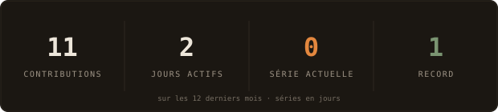
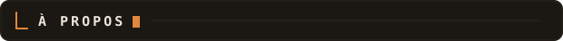
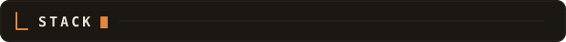
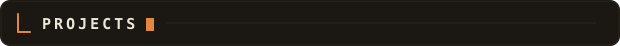
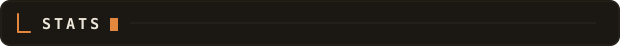
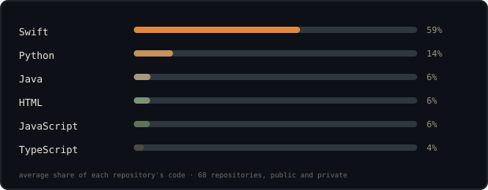
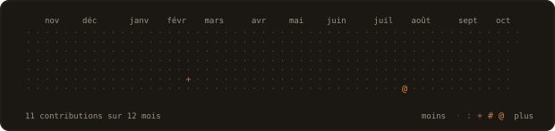
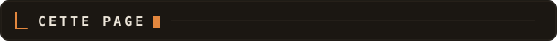

[youtube](https://www.youtube.com/@LaCobble) &nbsp;·&nbsp;
[github](https://github.com/LaCobble)

> Consultant sécurité le jour, bricoleur d'outils la nuit. 
> Petits outils précis plutôt que grandes plateformes vagues.

Je fais tourner **[La_Cobble](https://www.youtube.com/@LaCobble)**, une chaîne
cybersécu en français avec une identité "tanière" — anatomie d'arnaques,
sécurisation du quotidien numérique, et des défis OSINT ("La Tanière
enquête"). Entre deux vidéos, je construis des apps iOS natives pour mon
propre usage avant de les publier — et ce README lui-même.

<samp>swift &nbsp; swiftui &nbsp; swiftdata &nbsp; python &nbsp; fastapi &nbsp; typescript &nbsp; cloudflare workers &nbsp; supabase &nbsp; docker &nbsp; linux</samp>

**une quarantaine d'apps iOS** &nbsp;·&nbsp; <samp>swift, swiftui</samp> &nbsp;·&nbsp; <samp>en cours</samp> 
Des apps natives, petites et ciblées : jeux quotidiens, carnets, suivi,
outils du quotidien. Pas de tracking, le moins de backend possible.

**scout** &nbsp;·&nbsp; <samp>swift</samp> &nbsp;·&nbsp; <samp>bientôt public</samp> 
Scan réseau Wi-Fi et Bluetooth, en local, sans backend : ce qui est autour
de toi, et ce que ça expose.

**[la_cobble](https://www.youtube.com/@LaCobble)** &nbsp;·&nbsp; <samp>chaîne youtube</samp> 
Cybersécurité expliquée sans jargon inutile. Anatomie d'une arnaque, IA &
sécurité, sécurise ta vie numérique.

**ce README** &nbsp;·&nbsp; <samp>python, github actions</samp> 
Généré une fois par jour depuis l'API GraphQL de GitHub — voir plus bas.

Chaque graphique de cette page est généré, pas embarqué depuis le serveur de
quelqu'un d'autre. Les widgets de données ([`scripts/fetch_github.py`](scripts/fetch_github.py) +
[`scripts/render_*.py`](scripts)) et les titres de section sont dessinés
par [une Action programmée](.github/workflows/stats.yml), une fois par jour,
directement depuis l'API GraphQL de GitHub — elle ne commit que ce qui a
changé.

Le curseur des titres clignote en SMIL, dans le SVG lui-même, parce que
GitHub retire les scripts des README — et comme rien ne charge depuis un
serveur tiers, rien ici ne peut être rate-limité ou tomber. Les titres de
section sont aussi des images pour la même raison : GitHub retire aussi le
CSS, donc une image reste le seul moyen d'y mettre une typo qui ne soit pas
celle de GitHub.

La typo est [JetBrains Mono](fonts/README.md) (licence libre SIL OFL),
réduite aux caractères latins et intégrée en base64 dans chaque image.

Les langages comptent tous mes dépôts, publics et privés, chacun avec le
même poids : un dépôt qui embarque ses dépendances ne fausse pas tout le
reste. `year.svg` va du jour vide au plus intense sur une échelle de cinq
caractères : `·` `:` `+` `#` `@`.
