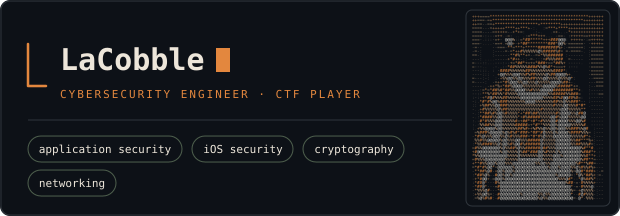

I also build native iOS apps (Swift, SwiftUI), designed for privacy from
the start: on-device processing, no tracking, as little backend as
possible.

**scout** &nbsp;·&nbsp; <samp>swift</samp> &nbsp;·&nbsp; <samp>coming soon</samp> 
Wi-Fi and Bluetooth network scanner, on-device, no backend: what's around
you, and what it exposes.

**[iOS apps](APPS.md)** &nbsp;·&nbsp; <samp>swift, swiftui</samp> &nbsp;·&nbsp; <samp>in progress</samp> 
Three dozen small, focused native apps: games, journals, trackers,
everyday tools. [See the catalogue →](APPS.md)

**[styx](https://github.com/LaCobble/Styx)** &nbsp;·&nbsp; <samp>python</samp> 
File and folder encryption: AES-256-GCM, Argon2id, streamed and tamper-evident.

<samp>swift &nbsp; swiftui &nbsp; python &nbsp; fastapi &nbsp; typescript &nbsp; cloudflare workers &nbsp; docker &nbsp; linux</samp>
